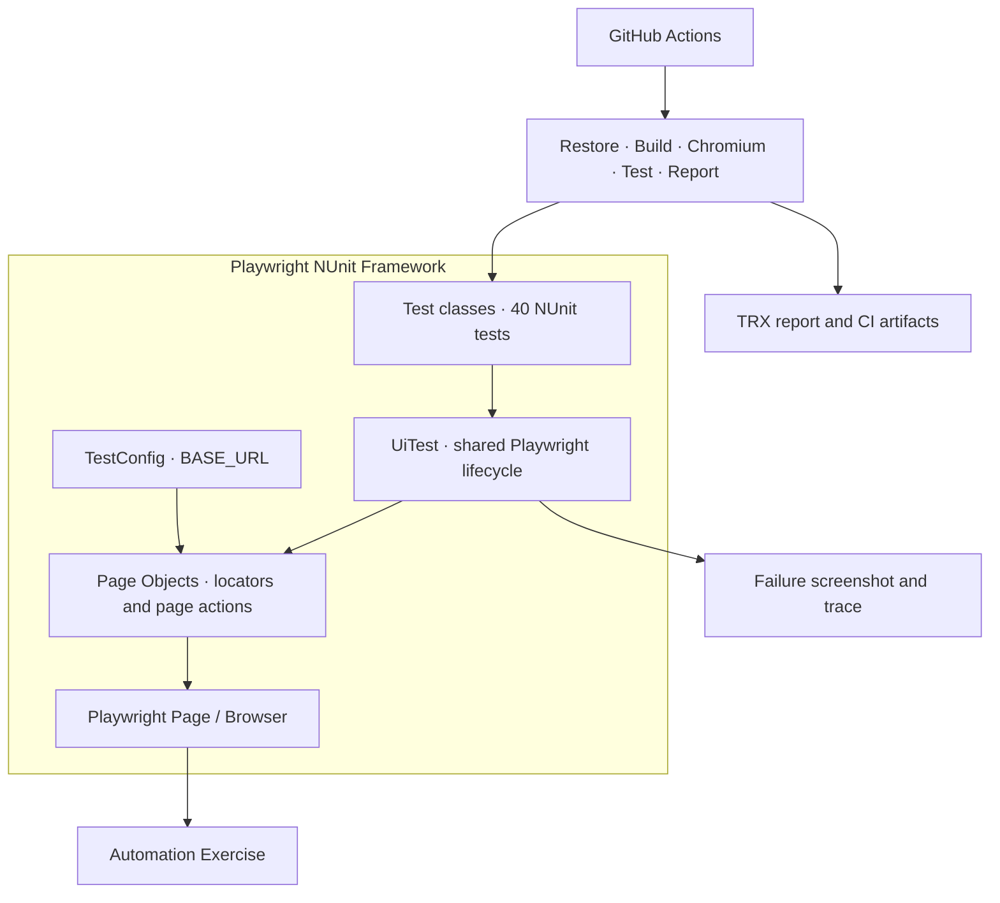

# SoftwareTestingExample2 — Playwright NUnit Automation Framework

[](https://github.com/huntersy/SoftwareTestingExample2/actions/workflows/playwright.yml)

A C# browser automation framework built with **Microsoft Playwright for .NET**, **NUnit**, and the **Page Object Model (POM)**. The project automates end-to-end user journeys against the [Automation Exercise](https://automationexercise.com/) practice application.

**Repository:** https://github.com/huntersy/SoftwareTestingExample2  
**Application under test:** https://automationexercise.com/

## Project highlights

- 40 NUnit automated UI tests organized across 8 test classes.
- Page Object Model with reusable page-level actions and locators.
- Coverage spanning homepage, product search and details, shopping cart, login, registration, and checkout.
- Structured JSON test lifecycle and diagnostic logging written to NUnit test output.
- Playwright tracing for every test and failure-only screenshots and trace archives.
- Configurable base URL through the `BASE_URL` environment variable.
- GitHub Actions workflow for automated build, browser setup, test execution, NUnit/TRX reporting, and artifact upload.
- Automated test-account cleanup in registration and checkout scenarios where applicable.

## Technology stack

| Technology | Version / role |
|---|---|
| C# | Test implementation language |
| .NET | 8.0 |
| Microsoft.Playwright.NUnit | 1.64.1 |
| NUnit | 3.14.0 |
| NUnit3TestAdapter | 4.5.0 |
| Microsoft.NET.Test.Sdk | 17.8.0 |
| NUnit.Analyzers | 3.9.0 |
| coverlet.collector | 6.0.0 (dependency included; coverage collection is not currently part of the CI workflow) |
| Browser in CI | Chromium |
| IDE | Visual Studio Code |
| Source control | Git and GitHub |
| CI | GitHub Actions |

## Framework architecture

The project uses the Page Object Model to separate test intent from browser interaction details.

### Architecture at a glance



Test classes define scenarios and assertions; `UiTest` provides the common Playwright test lifecycle and failure diagnostics. Page objects encapsulate browser interactions, while `TestConfig` supplies the application base URL. GitHub Actions builds the project, runs the suite, publishes the TRX report, and uploads available artifacts.

- **Tests** contain scenario steps and NUnit assertions.
- **Pages** encapsulate page-specific locators and reusable actions.
- **Utilities** centralize shared configuration.
- **TestData** is reserved for reusable test data.
- **UiTest** is the common NUnit/Playwright test base. It starts a Playwright trace for each test and, when a test fails, attempts to save a full-page screenshot and trace ZIP.

### Page objects

| Page object | Responsibility |
|---|---|
| `HomePage` | Homepage navigation and category interactions |
| `ProductsPage` | Product listing, search, product selection, and add-to-cart interactions |
| `ProductDetailsPage` | Product information, quantity, and add-to-cart actions |
| `CartPage` | Cart contents, quantities, totals, and item removal |
| `LoginPage` | Login form and logged-in/logged-out state |
| `RegisterPage` | Registration, account confirmation, and account deletion |
| `CheckoutPage` | Checkout details, addresses, payment, order confirmation, and invoice retrieval |

## Automated test coverage

The current repository contains **40 NUnit test methods across 8 test classes**.

| Test area | Test class | Tests |
|---|---|---:|
| Homepage and navigation | `HomePageTests` | 5 |
| Product search and input validation | `ProductSearchTests` | 12 |
| Product details | `ProductDetailsTests` | 4 |
| Product category filtering | `ProductFilterTests` | 1 |
| Shopping cart | `ShoppingCartTests` | 8 |
| Login and authentication | `LoginTests` | 3 |
| User registration | `RegistrationTests` | 1 |
| Checkout and order completion | `CheckoutTests` | 6 |
| **Total** | **8 test classes** | **40** |

### Test scenarios

<details>
<summary><strong>Homepage and navigation — 5 tests</strong></summary>

- `Homepage_ShouldLoadSuccessfully` — verifies the homepage loads and has a title.
- `TC02_ProductsPageSearchBoxIsVisible` — verifies the product search field is visible.
- `TC03_WomenCategoryExpandsSuccessfully` — verifies the Women category expands.
- `TC04_HomepageUrlIsCorrect` — verifies the homepage URL.
- `TC05_HomepageDisplaysProducts` — verifies products are displayed on the homepage.

</details>

<details>
<summary><strong>Product search — 12 tests</strong></summary>

- `TC06_SearchReturnsMatchingProducts` — matching product search.
- `TC07_SearchReturnsNoMatchingProducts` — no-results behavior.
- `TC08_SearchReturnsProductsUsingPartialName` — partial-name search.
- `TC09_SearchReturnsDressProducts` — dress search results.
- `TC10_SearchResultsCountMatchesDisplayedProducts` — result-count consistency.
- `TC13_SearchResultsHeadingIsDisplayed` — searched-products heading.
- `TC14_SearchReturnsMatchingProductsForUppercaseInput` — case-insensitive search behavior.
- `TC15_SearchForDressReturnsRelevantProducts` — relevance of dress results.
- `TC16_SearchReturnsSareeProducts` — saree search results.
- `TC17_SearchResultsDisplayPrices` — currency formatting for displayed prices.
- `TC21_EmptySearchTermIsRejected` — empty input validation.
- `TC22_WhitespaceSearchTermIsRejected` — whitespace-only input validation.

</details>

<details>
<summary><strong>Product details and category filtering — 5 tests</strong></summary>

- `TC11_OpenProductFromSearchResults` — opens a product from search results.
- `TC12_WomenTopsCategoryDisplaysProducts` — verifies products in the Women Tops category.
- `TC18_ProductDetailsDisplayCategory` — verifies product category information.
- `TC19_ProductDetailsDisplayPrice` — verifies product price information.
- `TC20_ProductDetailsDisplayInventoryAndBrandInformation` — verifies availability and brand information.

</details>

<details>
<summary><strong>Shopping cart — 8 tests</strong></summary>

- `TC23_AddProductToCartDisplaysConfirmation` — add-to-cart confirmation.
- `TC24_AddedProductAppearsInCart` — verifies the product appears in the cart.
- `TC25_CartDisplaysCorrectProductDetails` — verifies product, price, quantity, and total.
- `TC26_ProductQuantityCanBeSetBeforeAddingToCart` — verifies quantity selection.
- `TC27_ProductCanBeRemovedFromCart` — verifies cart item removal and empty-cart state.
- `TC28_MultipleProductsCanBeAddedToCart` — verifies multiple products can be added.
- `TC29_CartContentsRemainAfterPageRefresh` — verifies cart contents after refresh.
- `TC30_CartTotalReflectsSelectedQuantity` — verifies total calculation for selected quantity.

</details>

<details>
<summary><strong>Login and registration — 4 tests</strong></summary>

- `TC31_LoginPageDisplaysRequiredFields` — verifies required login fields.
- `TC32_InvalidLoginDisplaysErrorMessage` — verifies invalid-login feedback.
- `TC33_NewUserCanRegisterSuccessfully` — registers a unique test user, verifies the account, and deletes the test account.
- `TC34_RegisteredUserCanLogoutAndLoginAgain` — verifies logout and subsequent login.

</details>

<details>
<summary><strong>Checkout and order completion — 6 tests</strong></summary>

- `TC35_GuestCheckoutRequiresRegistrationOrLogin` — verifies guest checkout access control.
- `TC36_CheckoutDisplaysCorrectDeliveryAndBillingAddresses` — verifies delivery and billing addresses.
- `TC37_CheckoutDisplaysCorrectOrderDetails` — verifies checkout order details.
- `TC38_RegisteredCustomerCanPlaceOrderSuccessfully` — verifies a registered customer can complete an order.
- `TC39_CustomerCanDownloadInvoiceAfterPurchase` — retrieves and validates the generated invoice.
- `TC40_CartIsEmptyAfterSuccessfulOrder` — verifies cart state after order completion.

</details>

## Getting started

### Prerequisites

- [.NET 8 SDK](https://dotnet.microsoft.com/download/dotnet/8.0)
- [Git](https://git-scm.com/downloads)
- A supported operating system for Playwright browser execution
- Internet access to the practice application

### 1. Clone the repository

```bash
git clone https://github.com/huntersy/SoftwareTestingExample2.git
cd SoftwareTestingExample2
```

### 2. Restore dependencies and build

```bash
dotnet restore
dotnet build --configuration Release
```

### 3. Install the Playwright Chromium browser

**Linux / WSL:**

```bash
./bin/Release/net8.0/playwright.sh install chromium
```

**Windows PowerShell:**

```powershell
.\bin\Release\net8.0\playwright.ps1 install chromium
```

### 4. Run the test suite

```bash
dotnet test --configuration Release
```

Run an individual test by name:

```bash
dotnet test --configuration Release --filter "FullyQualifiedName~TC06_SearchReturnsMatchingProducts"
```

List the tests discovered by NUnit:

```bash
dotnet test --list-tests
```

## Environment configuration

The application base URL is centralized in `Utilities/TestConfig.cs`.

Default:

```text
https://automationexercise.com/
```

Set `BASE_URL` to run against another authorized test environment without changing the page objects.

**Linux / WSL:**

```bash
export BASE_URL="https://your-authorized-test-environment.example"
dotnet test --configuration Release
```

**Windows PowerShell:**

```powershell
$env:BASE_URL = "https://your-authorized-test-environment.example"
dotnet test --configuration Release
```

## Failure diagnostics

All test classes inherit from `UiTest` in `Tests/UiTests.cs`.

- A Playwright trace is started for each test with screenshots, DOM snapshots, and source capture enabled.
- Successful tests stop tracing without writing a trace archive.
- Failed tests attempt to save a full-page PNG screenshot and a Playwright trace ZIP.
- Diagnostic files are written under the test work directory in `TestResults/FailureArtifacts/`.
- The CI workflow uploads matching diagnostic files as artifacts, even when a test run fails.

A trace ZIP can be opened with the Playwright Trace Viewer:

```bash
./bin/Release/net8.0/playwright.sh show-trace path/to/trace.zip
```

The Trace Viewer makes it possible to inspect recorded actions, page snapshots, network activity, and captured screenshots to help investigate failures.

### Structured test logging

`Utilities/TestLogger.cs` writes one JSON record per framework event to NUnit's test output. Records include a UTC timestamp, severity level, event name, test class and test name, optional event properties, and exception details when available. The shared `UiTest` lifecycle logs test start and outcome, trace start and stop, screenshot and trace artifact paths, and diagnostic-capture errors. This keeps machine-readable event details alongside the test results without adding a separate logging dependency.

## Continuous integration — GitHub Actions

Workflow file: [`.github/workflows/playwright.yml`](.github/workflows/playwright.yml)

The workflow runs on:

- Pushes to `main`
- Pull requests targeting `main`
- Manual execution using `workflow_dispatch`

### CI pipeline

1. Checks out the repository.
2. Sets up the .NET 8 SDK.
3. Restores NuGet dependencies.
4. Builds the project in Release configuration.
5. Installs Playwright Chromium.
6. Runs the NUnit suite and writes a TRX results file.
7. Publishes a test report using `dorny/test-reporter`.
8. Uploads the TRX results and any failure diagnostics as a downloadable artifact.

### Verified CI execution

The workflow completed successfully for commit **`bb6717d`**.

| Result | Count |
|---|---:|
| Passed | 40 |
| Failed | 0 |
| Skipped | 0 |
| **Total** | **40** |

The test execution completed in approximately 92 seconds on the GitHub-hosted Windows runner. The report is published in the commit's **Checks** section, and the run's artifacts include the `playwright-test-artifacts` download.

- [View the successful GitHub Actions run](https://github.com/huntersy/SoftwareTestingExample2/actions/runs/44798980627)
- [View the commit checks and NUnit report](https://github.com/huntersy/SoftwareTestingExample2/commit/bb6717d6d49e23f55232c5361ebf6f0aaccec42d/checks)

CI results are specific to the commit and execution shown above; later code changes should be validated by a new workflow run.

## Repository structure

```text
SoftwareTestingExample2/
├── .github/
│   └── workflows/
│       └── playwright.yml
├── Pages/
│   ├── BasePage.cs
│   ├── CartPage.cs
│   ├── CheckoutPage.cs
│   ├── HomePage.cs
│   ├── LoginPage.cs
│   ├── ProductDetailsPage.cs
│   ├── ProductsPage.cs
│   └── RegisterPage.cs
├── TestData/
│   └── TestUsers.cs
├── Tests/
│   ├── CheckoutTests.cs
│   ├── HomePageTests.cs
│   ├── LoginTests.cs
│   ├── ProductDetailsTests.cs
│   ├── ProductFilterTests.cs
│   ├── ProductSearchTests.cs
│   ├── RegistrationTests.cs
│   ├── ShoppingCartTests.cs
│   └── UiTests.cs
├── Utilities/
│   └── TestConfig.cs
├── SoftwareTestingExample.csproj
├── README.md
└── .gitignore
```

## Scope and considerations

- This is an end-to-end UI automation project; Chromium is the browser installed by the current CI workflow.
- Tests interact with a public practice website. Its availability, data, catalog, and interface can change independently of this repository.
- Registration and checkout tests create test accounts and perform actions on the practice application. Use only environments where such activity is permitted.
- Payment details used by the checkout scenarios are synthetic test values for the practice site; do not use real payment information.
- The project includes the Coverlet collector package, but the current workflow does not publish a code-coverage report.
- Firefox, WebKit, parallel execution, and API test suites are not currently configured as part of this project.

## Project objective

This repository demonstrates practical QA automation engineering with C#, Playwright, NUnit, and the Page Object Model. It showcases maintainable test architecture, functional end-to-end coverage, reusable browser interactions, environment configuration, failure investigation, and automated CI validation.
